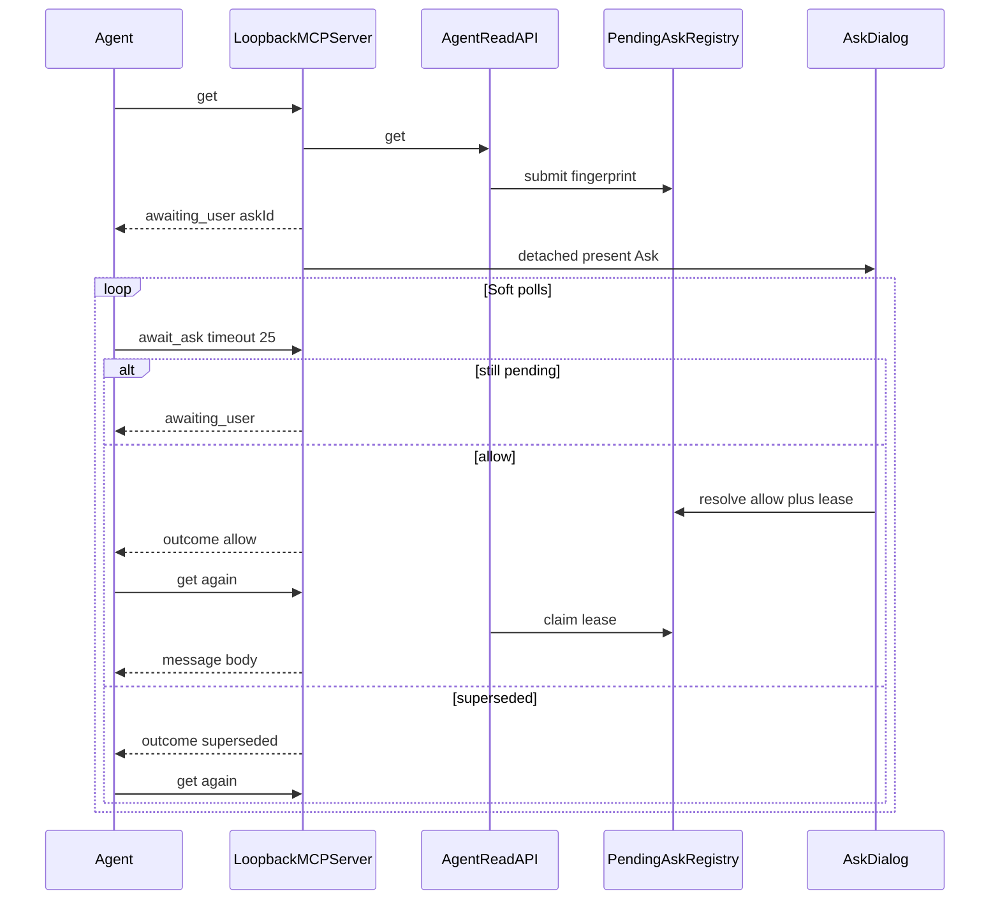

# Conditional Ask soft-await — mechanism design

Scratch only. Not product docs. Locked mechanism for evaluation → test plan → implementation.
Companion pattern: `propose_send` + `await_propose_send` (shipped).
Incident motivation: Grok Bot read-timeout evidence canvas
(`a8f0f4f8-8205-4793-8048-d6221a6b20d6`, 8 Nov 2026) — client `urlopen` timeouts 40s then 30s on blocking `get`; no pending-access state; not proven as a MailGent defect.

**Status:** Mechanism locked; matrix A–E green on `feat/await-ask`. No version bump until ship (0.24.0).
**Next:** Slice 6 ship closeout on user confirm (`0.24.0` + CHANGELOG + full README + signed tag).

---

## 1. Problem

Conditional Ask on `get` / `get_attachment` today **blocks the MCP HTTP call** until the human Allow / Block (`await prompter(…)` inside `AgentReadAPI.resolveConditionalFields`).

Clients have **different, often short, transport budgets**:

| Client | Observed soft budget |
|---|---|
| Cursor MCP tool call | ~60s drop (existing propose-revise docs say await ≤ 50) |
| Grok Bot (incident) | Python `urllib` `timeout=40`, retry `timeout=30` |

When the human takes longer than that budget:

1. The agent sees a **transport timeout**, not Allow / Block / pending.
2. It cannot tell “Ask is open” from “hung” from “denied”.
3. A retry may open a **second Ask** (idempotency undefined).
4. Whether the server keeps the prompt after client disconnect is **undefined**.

Longer client timeouts alone do **not** fix observability. MCP Tasks / elicitation are the right *protocol idea*, but Ask UI must stay **MailGent-on-the-Mac**, and host Tasks support is uneven. MailGent already solved the same class of problem for propose-send with an app-level soft-await.

---

## 2. Design principle

**Same mechanism as propose_send; separate tools; Ask UI stays native.**

| Layer | Owner | Role |
|---|---|---|
| Soft wait (`timeout` on await) | Agent passes; MailGent clamps | Return *before* the client kills the socket |
| Hard wait (`expiresAt`) | MailGent Settings (shared human-wait knob) | How long the human may decide |
| Ask / confirm UI | MailGent (macOS) | Never Cursor/Grok elicitation for this gate |
| Transport disconnect | Must not imply Block | Dialog stays until hard expiry or human decision |

Do **not** overload `await_propose_send` for read permission.
Do **not** put the agent’s soft timeout on the open call as a hard cancel.

---

## 3. Locked decisions

| # | Decision | Lock |
|---|---|---|
| L1 | Scope v1 = Conditional Ask on `get` and `get_attachment` only | Locked |
| L2 | `search` / `list` / `list_new` unchanged (no Ask) | Locked |
| L3 | New tool `await_ask` (not a generic mega-await in v1) | Locked |
| L4 | Open path returns immediately with `status: awaiting_user` + `askId` + `expiresAt` (normal tool result, not `isError`) | Locked |
| L5 | Soft `timeout` lives on `await_ask` only (agent-supplied, clamped) | Locked |
| L6 | Soft timeout never auto-Allow / auto-Block | Locked |
| L7 | After Allow, agent **re-calls `get` / `get_attachment`**. Post-Allow path is a short-lived **idempotent lease** (`askId` + authenticated `agentID` + exact request fingerprint). `await_ask` returns outcome only. `FieldAskDecisionCache` stays optional / off by default — lease is source of truth for this askId transaction | Locked |
| L8 | Fingerprint dedupe while pending (same agent + message + asked fields → same `askId`, one dialog) | Locked |
| L9 | Client disconnect / soft timeout / dropped await does **not** dismiss the Ask dialog and does **not** resolve as Block / cancel | Locked |
| L10 | Hard Ask lifetime = **shared** Settings human-wait knob with propose-send (default 1h, clamp 15m…8h) | Locked |
| L11 | No MCP Tasks / elicitation dependency in v1 | Locked |
| L12 | Do not merge Ask + propose_send into one public `await_user_action` tool in v1 | Locked |
| L13 | Access log: open ack + terminal await outcomes always; soft `awaiting_user` polls omitted by default. **Share** existing “Log soft-wait polls” toggle (rename Settings copy for both tools) | Locked |
| L14 | Versioning when shipped: new user-facing capability → **MINOR** `0.24.0` | Locked when shipping |
| L15 | Rule rematch → terminal `outcome: superseded` (agent re-calls `get` / `get_attachment`) | Locked |
| L16 | Soft default **25s** (under Grok ~30s socket); clamp **1…120**; never longer than remaining hard | Locked |
| L17 | `await_ask` / lease claim require `askId` owned by authenticated agent; else `unknown` | Locked |
| L18 | Unbound prompter → **fail closed** (deny Ask fields / error) — no legacy auto-allow | Locked |
| L19 | Soft sleep + hard expiry use `ContinuousClock` (injectable in tests); `Date` / `expiresAt` for display only | Locked |
| L20 | Window close / ⌘W → human **`block`** (not `expired`) | Locked |

---

## 4. Tools and wire shapes

### 4.1 `get` / `get_attachment` — when Ask is required

**Today:** blocks until human decides, then returns the message / attachment path.

**v1 when Ask needed and no cache/lease hit:**

```json
{
  "status": "awaiting_user",
  "askId": "<uuid>",
  "expiresAt": "<ISO-8601>",
  "pendingFields": ["Body", "Attachment content"],
  "accountID": "…",
  "placement": "…",
  "id": "…",
  "message": "Waiting for human conditional access. Call await_ask with this askId; do not treat this as denied."
}
```

`get_attachment` uses the same envelope; include `filename` in the ack for correlation.

**When Ask not needed** (grant On/Off, cache hit, lease claim, prompts disabled → deny-as-today): unchanged success / denial payload. No `askId`.

**Dedupe while pending:** identical fingerprint → same `askId` + same `expiresAt` (original hard deadline not reset). Response still `awaiting_user`.

### 4.2 `await_ask`

**Args:**

| Arg | Required | Notes |
|---|---|---|
| `askId` | yes | From open ack; must be owned by authenticated agent |
| `timeout` | no | Soft wait seconds; default **25**; clamp **1…120**; never longer than remaining hard deadline |

**Returns (non-terminal):**

```json
{
  "status": "awaiting_user",
  "askId": "…",
  "expiresAt": "…",
  "message": "Still waiting for human conditional access. Call await_ask again."
}
```

**Returns (terminal):**

| Outcome | Meaning | Agent next step |
|---|---|---|
| `allow` | Human Allowed the pending fields | Re-call `get` / `get_attachment` (lease claim; optional cache may also silence Ask) |
| `block` | Human Blocked (incl. traffic-light / ⌘W) | Do not expect those fields; may re-get for denied/sanitized shape |
| `expired` | Hard deadline passed; no decision | Treat as no access for those Ask fields (fail closed) |
| `superseded` | Rules rematched while pending | Re-call `get` / `get_attachment` for a new evaluation |
| error | Unknown `askId` / wrong agent / past retention | Do not invent a new Ask unless re-calling get intentionally |

Example allow:

```json
{
  "outcome": "allow",
  "askId": "…",
  "fields": ["Body"]
}
```

**Never** returns the message body. Body stays on `get` so one code path owns sanitization, leak-guard, and audit shape.

### 4.3 Soft timeout defaults (guidance for agents)

| Host | Recommended `await_ask` `timeout` |
|---|---|
| Cursor | ≤ 50 |
| Grok Bot / custom urllib | Below that client’s socket timeout (e.g. ≤ 25 if socket is 30) |
| Unknown | Start ≤ 25; lower if transport errors appear |

MailGent soft-returns first by design when the agent passes a sensible value. If the agent omits `timeout`, default **25** still races clients with sockets under 25s — document in tool description; do not fix foreign urllib defaults inside MailGent.

### 4.4 Optional later (YAGNI — not v1)

- Advisory `clientBudgetSeconds` on open `get` for UI/log only
- Generic `await_user_action`
- MCP Tasks bridge
- Returning full `get` payload from `await_ask`
- Backport ownership checks to `await_propose_send`

---

## 5. Lifecycle



### 5.1 Registry responsibilities (`PendingAskRegistry`)

Mirror `PendingProposalRegistry` where it fits:

| Concern | Behavior |
|---|---|
| Submit | Create entry or dedupe; schedule hard expiry |
| Fingerprint | `agentID` + `accountID` + `placement` + `messageID` + sorted pending field labels (+ `filename` for attachment-content Ask) |
| Soft waiters | Continuations woken on resolve / expire / supersede / soft timeout |
| Hard expire | Mark expired; dismiss UI via handler; wake waiters with `expired` |
| Allow lease | After `allow`, install lease keyed by askId+agent+fingerprint; `claimLease` idempotent until lease TTL / hard end |
| Supersede | Rule rematch → `superseded` (not `block` / not `expired`) |
| Ownership | `agentID(for:)` gate for await + claim; wrong agent → `unknown` |
| Terminal retention | Keep terminal outcomes briefly (**120s**) so a late `await_ask` still sees allow/block/expired/superseded |
| Client gone | No waiter left ≠ cancel; dropped soft-wait continuation must not resolve/cancel; entry stays until hard expiry or human decision |

### 5.2 Interaction with lease + optional `FieldAskDecisionCache`

1. Open Ask → **do not** write cache yet; **do not** install lease yet.
2. Human Allow → install lease; optionally write cache when Settings enable it.
3. Human Block → terminal `block`; no lease.
4. Agent re-`get` → lease claim for exact fingerprint+agent+askId → grant those fields without dialog; still re-check grants, rules, leak-guard, message existence before body.
5. Lease allows retry of the same approved read if HTTP drops; never another message / fields / agent.
6. Decision cache remains optional overlay; lease is the guaranteed post-allow path for this askId transaction.

### 5.3 Prompter / UI wiring

Today: `get` awaits `conditionalAccessPrompter` → `askDecision` → `runConditionalAsk` continuation.

v1: open path **submits + fires UI in a detached `Task`** (same pattern as `propose_send`), returns ack immediately. Resolve path writes registry (+ optional cache); `await_ask` claims the outcome.

- Window close / traffic-light / ⌘W → **`block`**
- Hard expiry dismiss → **`expired`** (distinct from block)
- Save rule → `rematchPendingAsks` → registry **`superseded`**
- Unbound prompter → fail closed (deny / error), never auto-allow

---

## 6. Failure and edge cases

| Case | Required behavior |
|---|---|
| Allow before soft timeout | `await_ask` → `allow`; re-get lease-claims body (subject to leak-guard) |
| Allow after client already timed out | Dialog still open; next `await_ask` or re-get after allow still works; transport error ≠ denial |
| Explicit Block / ⌘W | `outcome: block`; re-get returns denied/blocked field shape |
| No answer until hard expiry | `outcome: expired`; fail closed for those Ask fields; dismiss dialog |
| Rule rematch while pending | `outcome: superseded`; agent must new `get` |
| Soft poll returns `awaiting_user` | Agent must call `await_ask` again; dedupe if parallel get |
| Identical re-get while pending | Same `askId`; one dialog |
| Different fields / message / filename / agent | New fingerprint / new ask |
| Lost first response after allow | Second re-get still lease-hit (idempotent) |
| `get_attachment` Ask for content only | Same mechanism; fingerprint includes filename |
| Prompts disabled in Settings | No Ask; deny Ask fields as today (no `askId`) |
| Unbound prompter | Fail closed; never auto-allow |
| Unknown `askId` / wrong agent / past retention | Error / `unknown` parallel to propose_send unknown |
| Dropped await HTTP call | Must **not** cancel the pending Ask |
| Device / remote-monitor loss (Grok) | Local MCP + dialog continue on Mac; agent reconciles when reachable |

---

## 7. Observability

Agents and operators must distinguish:

| Signal | Meaning |
|---|---|
| `status: awaiting_user` | MailGent received the call; Ask is open (or still open) |
| `outcome: allow` / `block` / `expired` / `superseded` | Terminal human-or-hard-or-rematch decision |
| Transport / socket timeout | Client-side only; **unknown** server state until await/re-get |
| Normal get payload without `askId` | No Ask this call (grant, lease, cache, or prompts off) |

Access log:

- Open ack → type aligned with `get` / `get_attachment` (detail includes `awaiting_user · askId`)
- Terminal `await_ask` → type `await_ask`
- Soft polls → omitted by default; shared “Log soft-wait polls” toggle covers propose-send + Ask

---

## 8. Explicit non-goals (v1)

- MCP Tasks extension / `resultType: "task"`
- MCP elicitation for Conditional Ask
- Agent-supplied hard deadline on `get`
- Soft timeout on open `get`
- Auto-Allow / Auto-Block on any timeout
- Returning message bytes from `await_ask`
- Changing search/list to prompt
- Unifying propose_send and Ask into one agent-facing await tool
- Backporting ownership checks to `await_propose_send`
- Fixing Grok’s urllib defaults inside MailGent (document only)
- Live Grok Bot / AppKit pixel tests as ship gates

---

## 9. Acceptance (see test-plan.md)

Synthetic messages and controlled grants only — no personal mail. Matrix A–E in `test-plan.md` must be green under `make test` / script self-check before ship. Matrix F is explicit non-coverage.

---

## 10. Resolved evaluation points

| Point | Resolution |
|---|---|
| Shared vs separate hard-timeout Settings | **Share** one human-wait knob |
| Window close | **`block`** (not cancelled / not expired) |
| Expired vs block | Distinct outcomes; expired = fail closed |
| Open `awaiting_user` JSON-RPC | **Normal result** (not `isError`) |
| Dropped-await cancel hazard | Strictly avoid on Ask (L9) |
| Soft-wait audit toggle | **Share** + rename Settings copy |
| Soft default | **25s** |
| Post-Allow path | **Idempotent lease** (L7) |

---

## 11. Out of scope follow-ups (after this mechanism)

- GitHub issue (`roadmap` / `fog` as needed)
- README / CHANGELOG / version bump at ship (`0.24.0`)
- Optional MCP Tasks alignment if hosts mature

---

## 12. References (in-repo)

| Item | Path / note |
|---|---|
| Propose-send soft await | `PendingProposalRegistry`, `LoopbackMCPServer` `propose_send` / `await_propose_send` |
| Blocking Ask today | `AgentReadAPI.resolveConditionalFields` → `conditionalAccessPrompter` |
| Decision cache (optional) | `FieldAskDecisionCache` |
| Cursor / Grok soft-wait guidance | `Scripts/tests/await-ask/README.md` (default 25 under ~30); propose-send docs still say await ≤ 50 for Cursor |
| Implementation plan | `.cursor/plans/await-ask_implementation_269f744c.plan.md` (user plans) |
| Test matrix | `.scratch/await-ask/test-plan.md` |
| Incident | Personal-store canvas `a8f0f4f8-…` (Grok Bot, 8 Nov 2026) |
| MCP Tasks (non-goal v1) | modelcontextprotocol Tasks extension — durable poll handle; wrong UI owner for MailGent Ask |
