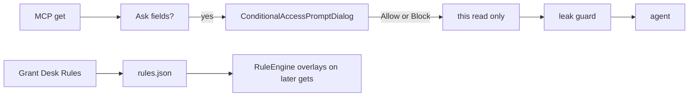

# Ask actions: Rules-from-Ask + manual redact

Product lock for optional actions on the conditional Ask dialog (`ConditionalAccessPromptDialog`). Spec both; **prototype and ship Rules-from-Ask first**; redact later.

## Locked decisions

### Ship order

1. Spec both features (this file + issues).
2. Prototype Rules-from-Ask (`issues/01`).
3. Implement Rules-from-Ask after prototype lock.
4. Redact after Rules-from-Ask ships or is parked (`issues/02`).

### Rule semantics (Rules-from-Ask)

- Creating or updating a Pass/Block from Ask is **optional**.
- Modes: **New rule** (append) or **Existing rule** (edit a rule already in `rules.json`).
- A saved/updated rule affects **future** matching mail only.
- The user must still press **Allow** or **Block** for the current `get`.
- Closing without Allow/Block still **Blocks** this read (fail-closed).
- Does **not** change `ConditionalAccessDecision` (stays `.allow` / `.block`).

### Reuse existing rule model

No new rule engine. Use [`GrantRule`](../../MailStore/Sources/RuleEngine.swift):

| Piece | Behavior |
|-------|----------|
| Match | From and/or Subject via `MatchMode` (exact / starts / ends / contains) |
| When | Optional `RuleWhen` After/Before (same shape as Grant Desk) |
| Polarity | Pass or Block |
| Fields | `GrantFields` overlay |
| Persist | Shared `rules.json` via existing RuleStore path |
| Enable | Current agent + account + placement (same as Grant Desk enablement) |

### Rules-from-Ask UI lock

- Optional disclosure: **“Also manage a rule…”** — collapsed by default so the dialog stays clean.
- Inside the panel: segmented **New** | **Existing**.
  - **New** — Name + Nick on one row; prefill From/Subject into the Add Value fields (not as chips); user must press **Add** to commit a matcher — Save does not auto-add draft values; default nick = next free shared letter; append on save.
  - **Existing** — pick a rule from the shared pool (picker; prefer surfacing likely matches for this From/Subject); load into the same compact editor; update in place on save.
- User can edit match value + match mode, polarity (Pass/Block), optional When (After/Before), and field chips.
- Field overlay default on **New**: the Ask fields on this prompt (Pass grants them; Block withholds them). On **Existing**: keep the rule’s current field overlay until the user tweaks it.
- **Save rule** / **Update rule** persists + enables for current agent + account + placement without dismissing Allow/Block (toast / chip “Rule A saved” / “Rule B updated”).
- Primary footer unchanged: **Block** | **Allow**.

### Redact product lock (spec only until Phase 3)

- Optional mode on Body preview: select span(s) → replace with a fixed mask (e.g. `[redacted]`).
- Allow then returns a **one-shot body override** for this `get` only (extend decision payload later); leak guard still runs after.
- Does **not** invent a persistent leak-guard rule unless the user later asks for “save as custom filter.”

## Current seams

| Surface | Path |
|---------|------|
| Ask UI | `MailGent/ConditionalAccessPrompt.swift` |
| Ask host | `MailGent/CompanionWindow.swift` (`DetachedWindowHost`) |
| Decision | `MailStore/Sources/AgentReadAPI.swift` → `ConditionalAccessDecision` |
| Rule authoring today | `MailGent/PassDeskPane.swift` via `AgentBridge.createRuleDraft` |

## Out of scope

- Auto-Allow / Auto-Block when saving a rule.
- Opening Grant Desk from Ask.
- Teaching the agent new MCP tools for redaction.
- Changing RuleEngine match semantics.
