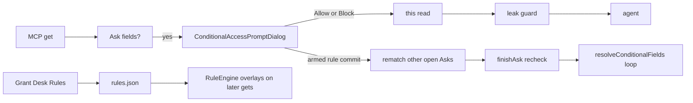

# Ask actions: Rules-from-Ask + manual redact

Product lock for optional actions on the conditional Ask dialog (`ConditionalAccessPromptDialog`). Spec both; **prototype and ship Rules-from-Ask first**; redact later.

## Locked decisions

### Ship order

1. Spec both features (this file + issues).
2. Prototype Rules-from-Ask (`issues/01`).
3. Implement Rules-from-Ask after prototype lock.
4. Redact after Rules-from-Ask ships or is parked (`issues/02`).

### Rule semantics (Rules-from-Ask)

- Creating or updating a Pass/Block from Ask is **optional**.
- Modes: **New rule** (append) or **Existing rule** (edit a rule already in `rules.json`).
- A saved/updated rule applies to **future** matching mail, and **rematches other open Asks** for the same agent when the rule can change them (Pass and Block; partial cover re-prompts leftovers only).
- The user must still press **Allow** or **Block** for the current `get` (Ask #1). Rematch never auto-answers that window.
- Closing without Allow/Block still **Blocks** this read (fail-closed); **no** rule write.
- `ConditionalAccessDecision` stays `.allow` / `.block` (cache + menu). Prompter may also return `.recheck` via `ConditionalAccessPromptOutcome` (never cached).

### Reuse existing rule model

No new rule engine. Use [`GrantRule`](../../MailStore/Sources/RuleEngine.swift):

| Piece | Behavior |
|-------|----------|
| Match | From and/or Subject via `MatchMode` (exact / starts / ends / contains) |
| When | Optional `RuleWhen` After/Before (same shape as Grant Desk) |
| Polarity | Pass or Block |
| Fields | `GrantFields` overlay |
| Persist | Shared `rules.json` via existing RuleStore path |
| Enable | Current agent + account + placement (same as Grant Desk enablement) |

### Rules-from-Ask UI lock

Locked to proto **variant G** (`examples/prototype-ask-rule-right.html?variant=G`) — field picks · right-pane editor · commit on Allow/Block. Variant A (left disclosure + separate Save) shipped in 0.12.0 and is historical.

- Envelope **Subject** / **From** trailing toggles: **Add to rule** ↔ **In rule** (`plus` → `checkmark`). To/Date keep inert placeholder slots for alignment.
- First pick opens the right editor; clearing all picks closes it and resets intent to New. Left column stays ask-only (no “Also manage a rule…” disclosure).
- Right pane: mail preview **or** rule editor (`Edit rule ›` / Close). Editor: segmented **New** | **Existing**.
  - **New** — Name + Nick on one row; draft From/Subject values prefill from picks (exact email / Subject text); non-empty drafts save with Allow/Block (no separate in-panel Save).
  - **Existing** — pick a rule from the shared pool (likely matches first); update in place on Allow/Block.
- User can edit matchers, optional When, field chips, and (folded) Pass/Block override. Polarity defaults from the decision (Allow→Pass, Block→Block) unless overridden; Existing keeps original polarity unless overridden.
- Footer: **Block** | **Allow** + fate `+ add rule` / `+ update rule` when picks non-empty; **Edit rule ›** / **Close rule edit** when armed.
- **Allow/Block commits the rule** when armed (`commitPickedRule`) + enables for prompting agent + account + placement. Closing Ask without Allow/Block still fail-closes this read; **no** rule write.
- Chrome (G): shared Ask auxiliary family — Preview, Open in Apple Mail, include-in-rule, AND/OR join, Close — height **20px**, font **11px**, radius **6px**, flush fill (no track gutter), subtle selected for include-in-rule.

### Redact product lock (spec only until Phase 3)

- Optional mode on Body preview: select span(s) → replace with a fixed mask (e.g. `[redacted]`).
- Allow then returns a **one-shot body override** for this `get` only (extend decision payload later); leak guard still runs after.
- Does **not** invent a persistent leak-guard rule unless the user later asks for “save as custom filter.”

## Cross-feature seams

[#21](https://github.com/marotron/MailGent/issues/21), [#22](https://github.com/marotron/MailGent/issues/22), [#32](https://github.com/marotron/MailGent/issues/32), and [#41](https://github.com/marotron/MailGent/issues/41) ship in any order. Identity is pairing `agentID` ([#31](https://github.com/marotron/MailGent/issues/31)): MCP and CLI on one endpoint share grants, rule enablements, and the Ask cache; another endpoint does not.

On every `get`: Scope grant → Pass/Block overlays → Ask only for fields still on Ask. Cache is per field for that `agentID` + message, and only for fields still on Ask. A rule save does not write the Ask cache. Rematch resumes other pending gets with `.recheck` so overlays re-apply; leftover Ask fields may open a new window. A redacted Allow stays one-shot until the cache entry can carry an optional body override.

## Current seams

| Surface | Path |
|---------|------|
| Ask UI | `MailGent/ConditionalAccessPrompt.swift` |
| Ask host | `MailGent/CompanionWindow.swift` (`DetachedWindowHost`) |
| Decision / rematch outcome | `MailStore/Sources/AgentReadAPI.swift` → `ConditionalAccessDecision` + `ConditionalAccessPromptOutcome` |
| Rematch gate | `MailStore/Sources/AskRuleRematch.swift` → `shouldRecheck` |
| Rule authoring today | `MailGent/PassDeskPane.swift` via `AgentBridge.createRuleDraft` |

## Out of scope

- Rematch on Grant Desk rule edits.
- Opening Grant Desk from Ask.
- Teaching the agent new MCP tools for redaction.
- Changing RuleEngine match semantics.
- In-place field shrinking without dismissing the window.
