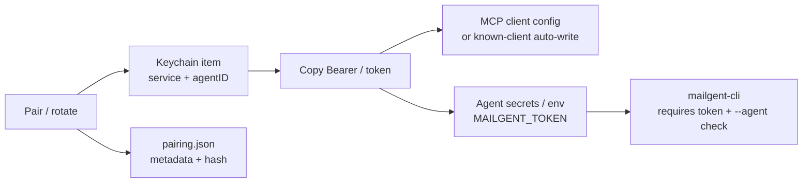

# 03 · Credential handoff (wizard + Keychain)

Type: decision  
Status: locked  
Blocked by: [02 · CLI wire format](02-cli-wire-format.md)  
GitHub: https://github.com/marotron/MailGent/issues/33

## Question

How should the Setup agent wizard handle **issuing / copying / storing** the per-agent Bearer (same secret as `MAILGENT_TOKEN`) so the agent side gets it **securely** — without baking secrets into pasteable MCP/CLI instruction blobs?

## Current product (today)

| Surface | Behavior |
|---------|----------|
| Auth | `Pairing` stores **SHA-256** of credential in memory; authenticate compares hashes. |
| Persist | `pairing.json` still holds **plaintext** credential (v2). Issue 02 + map already say Keychain becomes source of truth. |
| UI | **Copy Bearer** / **Copy MCP config** (config includes real Bearer today). Clipboard via `NSPasteboard` — no expiry clear. |
| Cursor special case | MailGent **writes** Bearer into `~/.cursor/mcp.json` on sync (secret on disk in user JSON). |

## Target model (recommended)

One secret per agent. Same bytes for MCP `Authorization: Bearer` and CLI `MAILGENT_TOKEN`.



### 1. MailGent stores the secret (always)

On Pair / re-issue:

1. Generate high-entropy token.
2. Upsert Keychain generic password (`SecItemAdd` / update on duplicate).
3. Persist **hash** for auth + metadata in `pairing.json` (no plaintext).
4. On Revoke: delete Keychain item + clear agent configs MailGent wrote.

**Keychain shape (proposed):**

- Class: `kSecClassGenericPassword`
- Service: `app.mailgent.agent-credential` (stable)
- Account: `agentID` (UUID — stable across rename)
- Label / description: agent display name (for Keychain Access UX)
- MailGent.app: data-protection keychain + app access group when signed/entitled ([TN3137](https://developer.apple.com/documentation/technotes/tn3137-on-mac-keychains))

### 2. Handoff paths (wizard Credential step)

**Locked:** callers must **possess** the secret. Keychain is MailGent’s vault only — not ambient authority for CLI.

| Path | When | How | Secret leaves MailGent? |
|------|------|-----|-------------------------|
| **A. Copy Bearer → agent secrets / env** | `allowsCLI` (required) | Copy secret only. Paste into *this* agent’s secret store or `export MAILGENT_TOKEN=…`. `mailgent-cli` requires the env token every call. | Clipboard briefly / agent store |
| **B. Auto-write known MCP client file** | Known local client (today: Cursor `mcp.json`) | Same as current sync — optional, machine-local only | Yes → client config file |
| **C. Copy Bearer → MCP paste once** | MCP clients without auto-write; recovery | Clipboard **clears after ~30s**. Paste into agent MCP headers / settings. | Clipboard briefly |

**Never** in “Copy setup instructions” / MCP JSON / CLI guide: the real token. Those stay placeholders (`<paste-MailGent-Bearer-here>`, `<MAILGENT_TOKEN>`).

**Rejected:** `mailgent-cli` silent Keychain lookup by `--agent` name (ambient authority; makes mismatch check a no-op).

### 3. `mailgent-cli` auth

1. **Required:** `MAILGENT_TOKEN` (or equivalent) on every call — same possession model as MCP Bearer.
2. **`--agent`:** mismatch check only — token → agentID; display name must match.
3. Keychain upsert at Pair stays in **MailGent.app** (SoT / revoke). Bundled CLI may share Team ID for other reasons; it must **not** auto-fill credential from name alone.
4. Optional later: interactive Keychain prompt for **humans** — not for unattended agent scripts.

### 4. Wizard step order

```
intro → credential → [mcp] → [cli] → done
```

**Credential step UI:**

1. Pair if needed (or show “already issued”).
2. Primary action: **Copy Bearer / token** (clipboard expiry ~30s).
3. Channel destinations that apply:
   - MCP → paste into agent MCP Authorization header; if Cursor-like auto-sync available → “MailGent can write mcp.json”.
   - CLI → paste into *this* agent’s secrets / `MAILGENT_TOKEN` (same bytes). Explicit: CLI does not unlock Keychain from name.
4. Hard rules (visible): not chat, not git, not argv, not email; revoke invalidates.
5. Advance only after Pair / issue.

## Out of scope

- OAuth / remote agents
- Sharing one Bearer across machines
- Putting secrets in Access Log payloads

## Security review (2026-10-13)

### Trust boundary

MailGent is **machine-local, same macOS user**. UDS + loopback do not defend against a process already running as you. Goal is: no remote expose, no secret in argv/docs/chat, per-agent grants, revoke works.

### What is sound

| Property | Verdict |
|----------|---------|
| UDS-only CLI (no TCP) | Sound — no network listener for CLI |
| Global **Enable local CLI** default off | Sound — explicit surface |
| One credential; hash auth; revoke deletes | Sound |
| Secret not in setup markdown / argv | Sound |
| MCP handoff = paste Bearer into *that* agent’s config | Sound — possession of secret = that agent |
| Keychain as MailGent vault (vs plaintext `pairing.json`) | Sound improvement |

### Critical tension: Keychain auto-read by `--agent` name

If `mailgent-cli` does: name → Keychain → present credential, then:

1. **`--agent` mismatch check becomes a no-op** — you always look up the same name you send. Issue 02’s “name is not identity; credential is” only holds when the credential is supplied **independently** (e.g. `MAILGENT_TOKEN`).
2. **`mailgent-cli` becomes ambient authority** — any same-user process that can exec the CLI and guess/know a display name can act as that agent (within its grants), **without** stealing a Bearer from an agent config.
3. That is **weaker agent isolation** than MCP, where another process must read that client’s config / steal the Bearer string.

Same-user malware with FDA is already catastrophic for mail; the realistic extra risk is **confused deputy / cross-agent**: Agent A’s script calls `--agent "Work"` and rides Work’s grants.

### Recommended lock (safe + still simple)

**Split storage from presentation:**

| Role | Behavior |
|------|----------|
| MailGent.app | Owns Keychain (SoT). Pair / revoke / Copy Bearer. |
| MCP agent | Must **possess** Bearer in its own config (paste or known-client auto-write). |
| `mailgent-cli` | Requires **`MAILGENT_TOKEN`** (or equivalent) on every call — same possession model as MCP. Does **not** auto-unlock Keychain from name alone. |
| `--agent` | Real mismatch check: env token → agentID; name must match. |

UX for CLI agents: wizard Credential step → Copy token → put in that agent’s secrets / shell env (once). Caller still only types `--agent "Name"` + JSON **if** the agent runtime injects `MAILGENT_TOKEN` from its secret store (mirrors MCP headers).

Optional later: interactive `mailgent-cli` with Keychain prompt for humans — not for unattended agent scripts.

### Rejected as default

- Name-only CLI with silent Keychain fill — elegant, **not** safe for multi-agent isolation on one Mac.

## Comments

### 2026-10-13

Investigation vs current code + issue 02. Proposal: wizard **credential** step; Keychain as SoT; secret-free instruction copies; clipboard expiry for manual paste.

### 2026-10-13 · security pass

Ambient Keychain-by-name undercuts issue 02 identity model. Prefer: Keychain = MailGent vault; CLI/MCP callers must possess token (env / client config); `--agent` stays a real mismatch check.

### 2026-10-13 · locked

Possession model locked. Proto wizard + handoff table updated (no Keychain-by-name). Status → locked.
