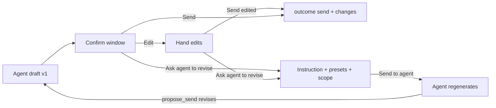

# Propose-send: Edit + Ask agent to revise

Scratch only. Not product docs. Proposal for the `propose_send` confirm window.
Prototype: [`prototype.html`](prototype.html) (open in a browser; not wired to Mail or MCP).
Related: #71 (human edits visible to agent), #61 (context thread graduate), #63 (secret constants).

**Status:** Proposal. Nothing implemented. No version bump. No CHANGELOG entry.

## 1. Vision in one paragraph

The agent drafts. The human steers. In the confirm window the human can **fix the words directly** or **ask the agent to rewrite** a whole draft or one passage, with a short instruction or a preset. Whatever the human did is handed back to the agent as an **explicit, typed record** (what changed, what was asked), never as a silent "it was sent". Secret constants stay tokens end to end, so the agent can work with them without ever learning their values.

## 2. The three moves

| Move | Human action | Agent receives | Ends the proposal? |
|---|---|---|---|
| **A. Edit** | Edit To / Cc / Bcc / subject / body text in place, then **Send edited** | `outcome: send` + `edited: true` + `changes` (field and hunk diffs) + final `sentBody` | Yes (sent) |
| **B. Revise** | **Ask agent to revise…** → presets and/or note, scope = whole draft | `outcome: revise_requested` + `revision` (instruction) + optional `userEdits` | No (agent re-proposes) |
| **C. Revise a passage** | Right-click a selection → **Rewrite selection…** / **Make shorter** / **Change tone…** | Same as B, with `scope: { type: "selection", quote }` | No |

B and C are the same mechanism with a different scope. A and B combine: the human can edit a few words **and** ask for a rewrite of another part; the agent gets both.

| Move | Human action | Agent receives | Ends the proposal? |
|---|---|---|---|
| **D. Refer to attention** (round 2) | Select text → **Refer to agent's attention** (optional note per pin). No rewrite requested. | `references` on the next reply (send, revise, or **Ask agent to look**) | No (only **Ask agent to look** sends the pins alone) |
| **E. Ask agent to look** (round 2) | Pins exist, no rewrite wanted → **Ask agent to look** | `outcome: attention_requested` + `references` + `context` + optional `userEdits` | No |

**Context on every reply (round 2).** Every outcome carries `context`: the case path, the events the human had on screen (`shownEventIds`), and the events they referred to (`referencedEventIds`). Ids only; the agent already has the content from its own vault and mail reads.

**Agent context uses the existing schema (round 2).** `propose_send` already takes an optional `context` (experimental, `MailStore/Sources/SendProposalContext.swift`): `casePath`, `caseLabel`, `events[]` (id, kind, scope, ownership, party, `at`, summary, source), and `links[]`. MailGent shows it in the left rail (`MailGent/SendProposalContextThread.swift`), with the draft as the last card. No new input field and no new card style. Gap: every event needs a mail or vault source, so a text-only note from the agent is not supported yet (open question 10).

### Flow



## 3. What the human sees

- **Edit mode.** To, Cc, Bcc, subject, and body become editable (plain text). Secret tokens render as atomic pills showing the value to the human (`+1 555 0142`), but cannot be half-edited. Deleting next to a pill removes the whole token.
- **Recipients.** A recipient the agent did not propose is shown explicitly in the confirm (for example "Added: Sam <sam@x.example>"), so the human sees who is new before pressing Send.
- **HTML drafts.** Edit converts the draft to plain text. The confirm says so before the first edit ("Editing turns this into plain text"), and the sent mail is plain text.
- **After edits.** A status chip "Edited · N changes · Revert". Changed words get a subtle highlight in the body.
- **Ask agent to revise.** A small popover (not a new window): scope chip (Whole draft / Passage "…"), preset chips (Shorter, Warmer, More formal, Plainer, Friendlier close, Change register…, Translate…), one optional note field, **Send to agent**. Nothing goes to the recipient on this path.
- **Waiting.** Window stays open: "Asked Cursor for a new draft". When the agent proposes again, the window updates to draft v2 (version chip).
- **Live payload panel (prototype only).** Shows the exact JSON the agent gets. Keep or drop in product; it is the trust feature, so it is worth at least a "Preview what Cursor receives" disclosure.

## 4. Protocol (agent-facing)

### 4.1 Outcome: `send` (extended)

```json
{
  "outcome": "send",
  "edited": true,
  "changes": {
    "to": { "before": "Joanna Chen <joanna@acme.example>", "after": "Joanna Chen <joanna@acme.example>, Sam <sam@x.example>" },
    "subject": { "before": "Re: Staff Engineer role", "after": "Re: Staff Engineer role, next steps" },
    "body": [
      { "before": "Thursday 2pm works", "after": "Friday 10am works better" }
    ]
  },
  "sentBody": "Hi Joanna,\n\n…[[mg:phone_mobile]]…"
}
```

- `to` / `cc` / `bcc` / `subject` appear only when changed. Recipients are sent as the full list before and after, so the agent sees who was added or removed.
- `edited: false` (or absent) → unchanged behaviour, nothing new for existing agents.
- `sentBody` is always the final tokenized body. The agent does not have to replay diffs to know what went out.
- `outcome: send` still means "Mail accepted the handoff" (unchanged semantics from #71 discussion).

### 4.2 Outcome: `revise_requested` (new)

```json
{
  "outcome": "revise_requested",
  "proposalId": "p_8f2c",
  "revision": {
    "scope": { "type": "selection", "quote": "I'd also like to hear more about the team's on-call rotation." },
    "presets": ["warmer"],
    "note": "keep the Thursday time",
    "instructionText": "Only change this passage: “I'd also like…”. Make it warmer. Note from the user: keep the Thursday time."
  },
  "userEdits": {
    "body": [ { "before": "Thursday 2pm works", "after": "Friday 10am works better" } ]
  },
  "currentBody": "…"
}
```

- `instructionText` is compiled by MailGent from the structured fields, so every agent gets the same human-readable sentence. Structured fields are for agents that want to branch on them.
- `userEdits` only when the human also edited. Tells the agent what the human wants kept.
- No new `proposalId`. The agent answers with `propose_send` plus `revises: { proposalId }` (see 4.3).

### 4.3 Tool change: `propose_send` gets optional `revises`

```json
{ "to": ["…"], "subject": "…", "body": "…", "revises": { "proposalId": "p_8f2c" } }
```

- Validates that the id belongs to the same agent and is in `revise_requested` state.
- Keeps the human's confirm window open and swaps the draft in place (v1 → v2). Dedupe via fingerprint still applies to identical bodies.
- Revision cap per proposal (proposal: **5**). After the cap, the window disables Ask agent to revise and shows "Send, Open in Mail, or Cancel".
- The hard expiry deadline is **not** reset by a revision (proposal; see open questions).

### 4.4 Context and references (round 2)

Shared fields, present on `send`, `revise_requested`, and `attention_requested`:

```json
{
  "context": {
    "casePath": "cases/jobs/acme-staff-engineer",
    "caseLabel": "Acme · Staff Engineer",
    "shownEventIds": ["e1", "e2", "e3"],
    "referencedEventIds": ["e3"]
  },
  "references": [
    {
      "id": "r1",
      "quote": "I'd also like to hear more about the team's on-call rotation.",
      "note": "Mention the on-call week we discussed in e3",
      "stale": false
    }
  ]
}
```

- `references` appear only when the human pinned passages. `quote` is tokenized and redacted like any other agent-facing text.
- **Anchoring.** A pin stores the tokenized quote, not offsets. The pin is re-found in the current body. If the passage no longer exists (for example after a hand edit or a revision), it is sent with `stale: true` and rendered struck through in the window.
- **Attention is not a change request.** `attention_requested` tells the agent to read the pins and reply, without changing the draft. The proposal stays open until the agent proposes again or the human sends or cancels.
- Passage pins do not double as revise scope. Revise sends the pins as context ("pinned for your attention") alongside the instruction.

**Agent input: `context` (existing, unchanged).** The rail items come from the agent's `context.events[]`. Ownership picks the side (`them` left, `you` right), `scope: private` puts the row on a darker band, and `source` is either `mail` (Open in Mail chip) or `vault` (file chip). Mail rows are fetched at confirm open. A missing source shows "unavailable" on the card.

### 4.5 Tool description update

`propose_send` and `await_propose_send` descriptions need the new outcomes and a line such as: "If outcome is `send` with `edited: true`, the human changed the draft; treat `sentBody` as what was sent. If outcome is `revise_requested`, rewrite per `revision.instruction`, keep `userEdits` unless they conflict, and call `propose_send` again with `revises.proposalId`. Do not re-propose the same mail unchanged."

Remember the `mcp-tool-catalog-restart` rule: changing descriptions alone on an existing tool may not reach a running client; new tools would need a Cursor restart.

## 5. Secret constants: non-negotiable rules

The agent must never learn a secret value through this feature. Rules, in priority order:

1. **Edit operates on the tokenized source.** The editor renders `[[mg:name]]` as a non-editable pill that shows the value to the human. The stored body stays tokenized. Diffs are computed on tokenized text, never on resolved text.
2. **Typed literal → token when allowlisted (body only).** If the human types the exact value of a constant the agent is allowed to reference, MailGent turns it into `[[mg:name]]` on commit. The agent sees the token, not the literal. Tokens exist only in the body in v1 (matches #63 Q1), so a literal typed into To / Cc / Bcc / subject is not tokenized. It is redacted in agent-facing output (rule 3) and still goes out as typed.
3. **Typed literal → `[redacted]` when not allowlisted.** Anything else that matches a constant value is redacted in agent-facing output. Named marker `[redacted:name]` only for allowlisted constants (Q19/Q21 in #63).
4. **Selections map back to tokens.** A selection spanning a pill is snapped to whole tokens, and the quote is sent in token form. Quotes and notes then go through the same redaction pass.
5. **Free-text note and preset labels go through redaction too.** The human may type a value into the note field.
6. **Leak guard still runs on everything agent-bound.** The new outcome payloads are added to the outbound path, not a parallel one.
7. **Human-only audit may show values** (Q18). The agent-facing audit row (`outcome`, counts, proposalId) does not.
8. **Revise never resends values.** `currentBody` is the tokenized body, not the rendered view.

Failure mode to test explicitly: human selects "+1 555 0142" (displayed value) inside a passage and clicks Rewrite. Agent must see `[[mg:phone_mobile]]` in `quote`.

## 6. Interaction with what already exists

- **`propose_send` confirm (`SendProposalPrompt.swift`, `SendProposalConfirmModel.swift`).** Gains an edit mode and a footer action. Existing Send / Open in Mail / Cancel stay.
- **Ask chrome.** Reuse `AskPreviewZoomControls` / `AskPreviewHoverTracker` for the preview, and the existing footer button style. The revise popover is composed locally (no inventory row mid-feature, per `ui-inventory.mdc`).
- **Context thread (#61).** Edits to the mail body do not change context events. Revisions could propose new context, but out of scope for v1.
- **Access log.** New audit detail: `edited · 2 changes` / `revise_requested · selection · warmer`. Agent-facing summary stays counts-only.
- **Secret constants catalog (#63).** No new settings needed. Uses the existing allowlist and value detector.

## 7. Scope and slices (proposed)

Vertical slices, each shippable and dogfoodable:

1. **Edit + Send edited.** Editable To / Cc / Bcc / subject / body, token pills, diff, recipient "added" callouts, HTML → plain notice, `send` extension (`edited`, `changes`, `sentBody`). Closes #71's core ask. Tests: pure diff, token read-back, literal→token, redaction, recipient diff.
2. **Ask agent to revise (whole draft).** Presets + note + popover + `revise_requested` outcome + `instructionText`. No `revises` yet; the window closes into "waiting" and the agent re-proposes as a fresh proposal (fallback).
3. **Agent loop.** `propose_send.revises`, in-place v2 swap, revision cap, tool description update, restart note for clients.
4. **Passage scope.** Right-click on selection, snapping to tokens, scope chip. Riskiest plumbing (WebKit HTML selection vs NSTextView raw). Consider starting with raw/plain-text mode only.

Round 2 (refer to attention + context on replies) pulls the selection plumbing from slice 4 forward. Refer needs no LLM work, so it is cheap once selection works. It can ship with slice 2 as an "attention" outcome, before the revise loop.

Recommendation: ship slice 1 first (it also answers the #71 acceptance list). Slice 2 + 3 together, because a revise without the loop is a dead end. Slice 4 last.

## 8. Implementation sketch (not started)

- **MailStore (pure, testable):**
  - `ProposalDiff`: word-level LCS over tokenized text, merged hunks, ranges in body coordinates (the prototype's `diffHunks` is the reference).
  - `ProposalRevision` model + `instructionText` compiler.
  - `ProposalOutcomePayload` builder (send / revise_requested) with redaction and leak-guard pass.
  - Revision cap and state transitions in `PendingProposalRegistry`.
- **MailGent (UI):**
  - Editor: `NSTextView` wrapper that supports atomic attachments for tokens (SwiftUI `TextEditor` cannot do atomic inline pills). Deployment target is macOS 14.0; check the attachment APIs with apple-doc-mcp before committing.
  - Popover and context menu: SwiftUI, composed locally.
- **Tests to write (after confirmation, per `/tdd`):** diff hunks; recipient diff (added / removed); token snapping on selection; literal→token (body only); redaction in quote / note / body / subject / recipients; `send` edited vs not; revise state machine; cap.

## 9. Decisions and open questions

**Decided (2026-11-05):**

- **Editable fields:** To, Cc, Bcc, subject, and body. Recipients are the highest-risk field, so the confirm calls out any added recipient and the agent receives the before/after list.
- **HTML drafts:** edit as plain text, and send as plain. The confirm warns before the first edit.
- **Typed allowlisted secret literal:** auto-tokenize to `[[mg:name]]` in the body. Literals in envelope fields are redacted in agent output (see section 5, rule 2).

**Still open:**

1. **Literal typed secret in recipients or subject.** Proposed: no block, just redaction in agent output. Alternative: block Send until removed (fail closed). Recipient or subject values almost never hold secrets, so the proposal may not need the block.
2. **Presets for v1.** Proposed: Shorter, Warmer, More formal, Plainer, Friendlier close, Change register…, Translate…. Keep the two "…" items as note prompts?
3. **Revision cap.** 5 per proposal (proposed). Or unlimited with only the expiry as a stop?
4. **Expiry on revise.** Keep the original hard deadline (proposed) or restart it?
5. **Live payload panel.** Always visible in product, or a disclosure ("What Cursor receives")?
6. **Right-click passage (slice 4).** In v1, or after dogfooding slices 1–3?
7. **Agents without `revises` support.** Fall back to fresh proposal (slice 2) or require the loop?
8. **Version.** New capability = MINOR under `versioning.mdc` (e.g. `0.24.0`), with CHANGELOG + README in the same commit when shipped. Not now.
9. **Tracking.** Fold into #71 (edit) and file a new `roadmap` / `fog` issue for revise + passage scope? Not filed yet.
10. **Text-only agent context.** Every rail item needs a mail or vault source today. Keep that (the agent points at a vault note), or allow a source-less summary card? A source-less card would need its own honest label, since it has no original to open.

## 10. Do not

- Do not send resolved values in `changes`, `revision`, `userEdits`, or `currentBody`.
- Do not let the human edit inside a token pill.
- Do not treat `revise_requested` as sent or cancelled. The proposal stays open.
- Do not add editable fields beyond To / Cc / Bcc / subject / body without a new decision.
