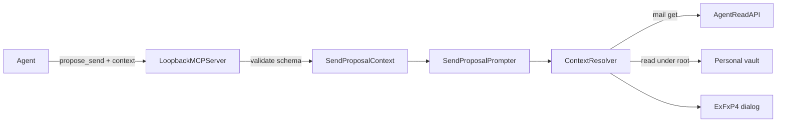

# Propose-send context thread — brainstorm

Scratch only. Not product docs. Companion to `prototype-context-thread.html`.

**Status:** Locked for experimental implementation on `feat/propose-send-context-experimental`. Not a mainline release until graduated.

## Problem / user moment

Agent calls `propose_send`. You see Send / Open in Mail / Cancel. The draft looks fine in isolation — but the judgment you need is “does this fit the case?” That context lives in Personal (`LOG.md` / notes / phone) plus prior mail. Today the confirm has none of it.

## Locked decisions

- **Surface:** extends today’s `propose_send` confirm, not a new top-level app.
- **Experimental:** Settings → Experimental toggle (off by default) + Personal vault root (security-scoped). When off, ignore `context`.
- **Vault:** configured Personal root in Settings (not hard-coded). Cases with `LOG.md` / notes; mail via store `get`.
- **Assembly (C):** agent decides **structure and connections**; **MailGent pulls content** (mail + vault under root).
- **UI mashup:** **E-thin × F-full × P4**
  - **Thin rail:** Variant **E** — shared L/R avatar columns; cards stretch toward opposite avatar; peek/overlap; no chevrons
  - **Full rail:** Variant **F** — draw.io ownership rails, **avatar only** (no sense icons above), centered chevron
  - **Preview:** **P4** Spotlight — dim history ~0.72 when draft focused; past click clears; draft click restores
  - Boot thin; footer right-aligned: Cancel · Open in Mail · Send
- **Draft row:** synthetic, always last, from proposal envelope — not listed in `context.events`.
- **Thread content (hybrid):** email + vault log / notes / phone as one timeline; compact by default, expand for detail.



## Protocol (agent → MailGent)

Optional `context` on `propose_send` (existing `to` / `subject` / `body` / `cc` / `bcc` / `sender` unchanged):

```json
{
  "to": ["Joanna Chen <joanna@acme.example>"],
  "subject": "…",
  "body": "…",
  "sender": "you@example.com",
  "context": {
    "casePath": "cases/jobs/acme-staff-engineer",
    "caseLabel": "Acme · Staff Engineer",
    "events": [
      {
        "id": "e1",
        "kind": "phone",
        "scope": "private",
        "ownership": "you",
        "at": "2026-10-20T11:40:00Z",
        "summary": "Prep notes before Joanna call",
        "source": { "vault": { "path": "LOG.md", "anchor": "2026-10-20-prep" } }
      },
      {
        "id": "e2",
        "kind": "mail",
        "scope": "shared",
        "ownership": "them",
        "party": { "name": "Joanna Chen", "initials": "JC" },
        "at": "2026-10-21T09:12:00Z",
        "summary": "Thanks for chatting yesterday",
        "source": {
          "mail": { "accountID": "…", "placement": "INBOX", "id": "…" }
        }
      }
    ],
    "links": [
      { "from": "e2", "to": "e3", "rel": "reply-to", "label": "Reply" }
    ]
  }
}
```

| Field | Rules |
|-------|--------|
| `casePath` | Required when `context` present. Relative to Settings vault root; no `..` / absolute escapes |
| `caseLabel` | Optional header label; else last path component |
| `events[].id` | Required, unique within the proposal |
| `kind` | `mail` \| `phone` \| `video` \| `note` \| `log` |
| `scope` | `private` \| `shared` — private → grey band, no ownership rails |
| `ownership` | `them` \| `you` \| `both` — drives L/R sharp corner + avatar side |
| `party` | Required for `them`/`both` when shown; `{ name, initials? }` |
| `at` | ISO-8601; sort key (stable secondary: agent order) |
| `summary` | Compact card line (agent-authored) |
| `source.mail` | Same triple as MCP `get`: `accountID`, `placement`, `id` |
| `source.vault` | `{ path, anchor? }` under `casePath` |
| `links` | Optional; full-rail chips only (thin hides labels) |

**Caps / fail:** max 40 events (tool error if more); unknown kind / missing source → tool error; mail/vault resolve soft-fail per row (keep summary + “unavailable”).

## Deferred (GitHub on graduate)

- Reply-aware context when draft is a reply
- Pagination / large event lists
- Richer LOG anchors
- Bridge / transfer reveal variants (A–C), other preview treatments

## Prototype

`prototype-context-thread.html` — locked default **E-thin × F-full × P4**; switchers kept for reference.
