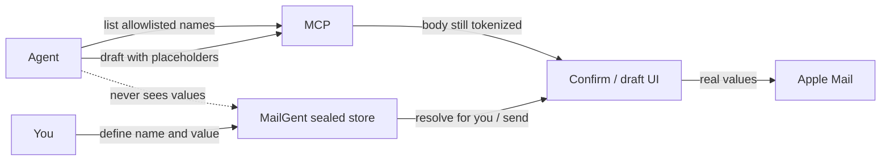

# Secret constants (idea draft)

Scratch-only concept. Not product docs. Not an implementation plan yet.

**Working name:** Secret constants (aliases: private fields, send placeholders). Distinct from **Personal vault** (case notes / LOG.md for propose-send context) and complementary to **leak guard** (redacts secrets *leaving* to agents).

**Status:** Grilled + catalog UI locked. Prototype variant **C** approved (visual source of truth). Implementing on `feat/secret-constants` per plan. Tracker: [#63](https://github.com/marotron/MailGent/issues/63) (`enhancement`, `roadmap`, `fog`).

## Problem / user moment

You want an agent to write a reply that *includes* something sensitive (phone number, home address, account ID) without the agent ever learning that value. Today the agent either:

- invents or asks you to paste the secret into chat (leaks to the model), or
- omits it and you finish the mail by hand.

MailGent already keeps inbound secrets away from agents via leak guard. This idea covers the other direction: **inject** a secret into outbound mail **without** the agent seeing it.

## Core idea

MailGent holds a small, user-managed collection of **named constants** (key → secret value). Agents may:

| Allowed | Forbidden |
|--------|-----------|
| Learn **names**, labels, and hint categories of constants **on their allowlist** | Read or infer **values** via MCP, Ask, or context thread |
| Put **placeholders** in draft / `propose_send` body (v1) | See values in agent-facing tool results (Access log is human-only and may show values) |

MailGent substitutes placeholders with real values **only on the local path** (confirm UI for you, Apple Mail draft / send). The agent’s view of the draft stays tokenized.

### Example

1. You define `phone_mobile` = `+1-555-…` (value never in MCP responses).
2. Agent (allowlisted) lists available constants → sees `phone_mobile` (+ label / hint).
3. Agent writes: `You asked for my number — it's [[mg:phone_mobile]].`
4. You confirm in MailGent; preview shows the real number to **you**, with substituted spans highlighted.
5. Sent mail contains the real number. Agent transcripts / tool results still show only `[[mg:phone_mobile]]`.



## Decisions (grill 2026-10-29)

| # | Topic | Decision |
|---|--------|----------|
| Q1 | Insertion surfaces | **v1: body only.** Grammar/resolver designed so later versions can cover subject / headers / attachments (“pretty much anywhere”). |
| Q2 | Token syntax | `[[mg:name]]` |
| Q3 | Confirm UI | Fully **resolved** for you, with **highlight** on each substituted span |
| Q4 / ownership | Store model | **Global** constants; **per-agent allowlist** of names (permission, not duplicate values) |
| Q5 | Agent-visible metadata | `name` + `label` + optional `hint` category |
| Q6 | Missing / unknown token | **Fail closed** — block Send / Open in Mail; show which tokens are unknown |
| Q7 | Allowlist vs list | `list_secrets` returns **only** allowlisted names for that agent |
| Q8 | Hint categories | **v1 closed enum:** `phone` \| `address` \| `id` \| `other` (free-string / hybrid later) |
| Q9 | Name charset | Store/validate lowercase snake_case: `[a-z][a-z0-9_]*`; reject others at create |
| Q10 | Leak guard × values | Every stored constant **value** is an extra leak-guard pattern when leak guard is on; redaction reason distinguished as secret-constant |
| Q11 | vs Personal vault | **Hard split v1:** vault never resolves `[[mg:]]`; constants never exposed via vault to agents. Vault↔agent design may change later without merging stores. |
| Q12 | Value changed after draft | **Live bind** to current value; subtle “updated” affordance on confirm chip (no modal) |
| Q13 | Storage | **B′:** sealed App Support catalog (~10–50 constants) + **one** Keychain wrapping key |
| Q14 | MCP list | Dedicated `list_secrets` → `{ name, label?, hint? }[]` (allowlist-filtered). Empty list if none granted — not an error. |
| Q15 | Tools accepting tokens (v1) | `propose_send` + `create_draft` / `update_draft` |
| Q16 | UI | **Split:** Settings = setup only (master toggle + link). **Control Center → Secret constants…** detached window = CRUD + per-constant agent allowlist. Sibling to Grant desk / Access log — **not** Grant Desk as primary allowlist UI. **Catalog chrome (locked):** list + detail (**variant C**); name badges in list; wider left pane; detail uses Settings-style rows (label left / control right) and agent **toggles**. |
| Q17 | Ship gate | Master **Secret constants** Settings toggle; when off, no tool / no resolve (catalog UI read-only / dimmed); when on, allowlists still apply |
| Q18 | Access log | Human-only. May show **resolved values**, presented so it’s clear constants were used. Log tool, agent, names, outcome; agents must never read this log. |
| Q19 | Agent redaction marker | Allowlisted agents see a **named** marker (e.g. `[redacted:phone_mobile]`) so they can connect to the same constant — **never** the value |
| Q20 | “Changed since draft” loudness | Subtle chip affordance only (v1) |
| Q21 | Name in redaction vs allowlist | **Not allowlisted** → generic `[redacted]`; **allowlisted** → named marker |
| Q22 | Value length / lines | **Optional multiline** values (addresses, etc.). Single-line default; catalog Edit can switch to multiline textarea. Resolver / leak guard treat the full string (newlines preserved). |
| Q23 | Agent list source | **One place:** Control Center paired agents (`AgentBridge.pairedAgents` / pairing store). Secret constants **Allowed agents**, Grant Desk, Access log, leak-guard scope, MCP — all consume that same list. Catalog must not invent agents that are not paired. Today’s presets: **Cursor** and **Grok Bot**. Adding/removing agent kinds beyond pair/revoke may come later; presence still flows from Control Center. |

### Surfaces (Q16 / Q17)

```
Settings → Enable secret constants (master toggle)
         → “Manage in Control Center → Secret constants…”

Control Center → Secret constants…  (DetachedWindowHost)  · proto C approved

┌ list (wider) ──────────────────┐┌ detail ─────────────────────────────┐
│ [phone_mobile]  Mobile · 🟢🟢  ││ head: badge … Edit                  │
│ [home_address]  Home · 🟢🟢    ││ Constant card (grey header)         │
│ [tax_id_last4]  Tax ID …       ││   Label / Hint / Value (Show)       │
│ [Add constant]                 ││   Token preview card + Copy         │
└────────────────────────────────┘│ Allowed agents (view: allowed only) │
                                  │ Edit: all paired + switches         │
                                  └─────────────────────────────────────┘
```

- List meta: `label ·` + right-aligned agent glyph cluster; nothing when allowlist empty
- Value: Show left of field; multiline icon = **target** mode; optional textarea
- Token preview = output card (not a settings row)
- Master off → catalog dimmed / read-only (proto banner)

Prototype: [`.scratch/secret-constants/prototype-catalog.html`](prototype-catalog.html) (default `?variant=C`) — **approved**.

## How it fits what already exists

- **Leak guard** — inbound/outbound *to agents*: strip or redact secrets. Secret constants add value-based patterns (Q10) with distinct reason; inject path is the inverse for outbound *to recipients*.
- **Personal vault** — judgment notebook for you on confirm. Hard split from constants (Q11).
- **`create_draft` / `update_draft` / `propose_send`** — accept placeholders in body; resolve at confirm / handoff to Mail; tool returns stay tokenized.
- **Access log** — human-only; may reveal values with clear constant-used presentation (Q18).
- **Paired agents (Q23)** — Control Center is the roster. Secret-constants allowlist toggles are permissions over that roster, not a second agent directory.

## Non-goals (for this idea)

- Not a general password manager or iCloud Keychain sync story (local MailGent store first).
- Not agent-writable secrets.
- Not substituting into *inbound* mail for agents beyond leak-guard redaction of constant values.
- Not exposing vault file contents as constants.
- Not per-agent duplicate value stores (allowlist only).

## Residual fog (non-blocking)

- Exact agent-facing redaction string format (`[redacted:phone_mobile]` vs similar).
- ~~Whether master toggle hides `list_secrets` from the tool catalog entirely vs returns an error/empty.~~ → **Always list** `list_secrets` in `tools/list`; call fails closed with “disabled” while Settings toggle is off (Cursor and similar clients often cache the tool catalog and won’t pick up a newly added tool without reconnect).
- Future surfaces (subject / headers / attachments) — grammar only, not v1 UI.
- Vault↔agent redesign — must preserve Q11 (no value channel via vault).

## Next

1. ~~File GitHub issue~~ → [#63](https://github.com/marotron/MailGent/issues/63)
2. ~~Grill~~ → decisions above
3. ~~Catalog chrome~~ → proto **C** approved
4. Implement on `feat/secret-constants` (MailStore core → sealed store → leak → MCP → confirm → catalog UI → access log → `0.22.0`).
