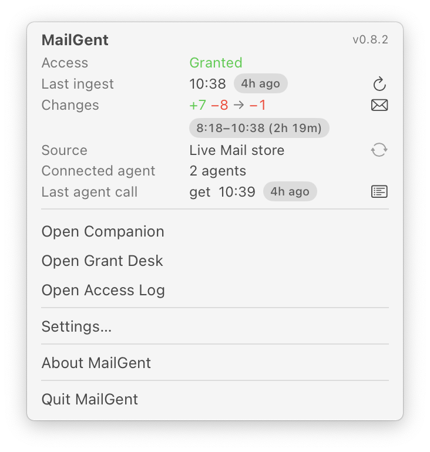
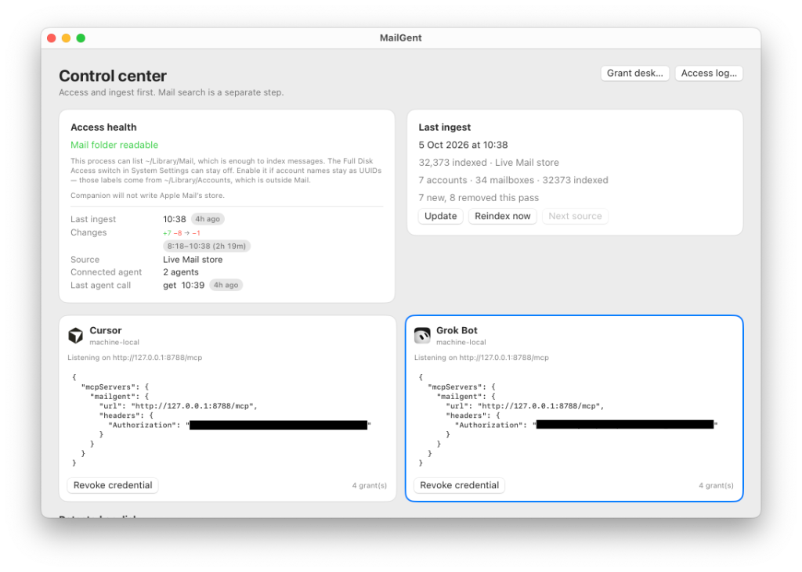
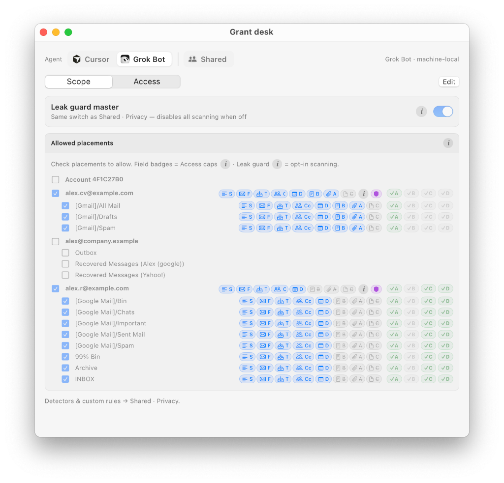
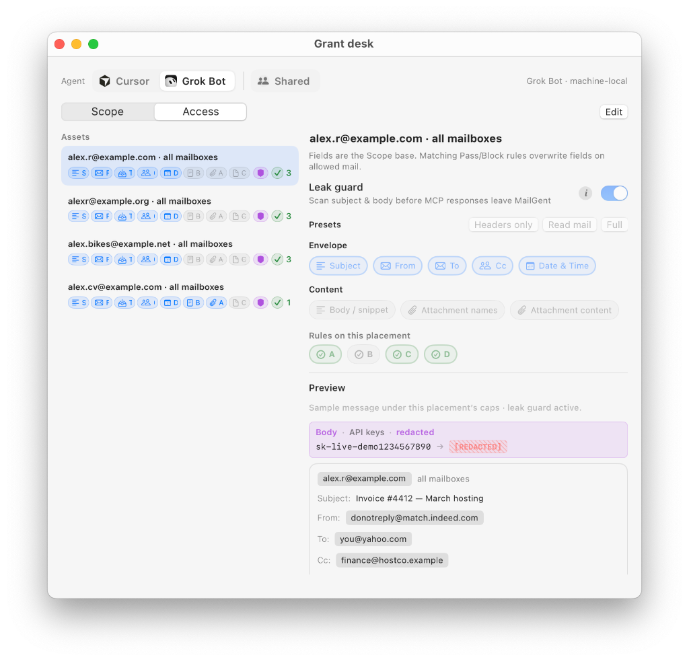
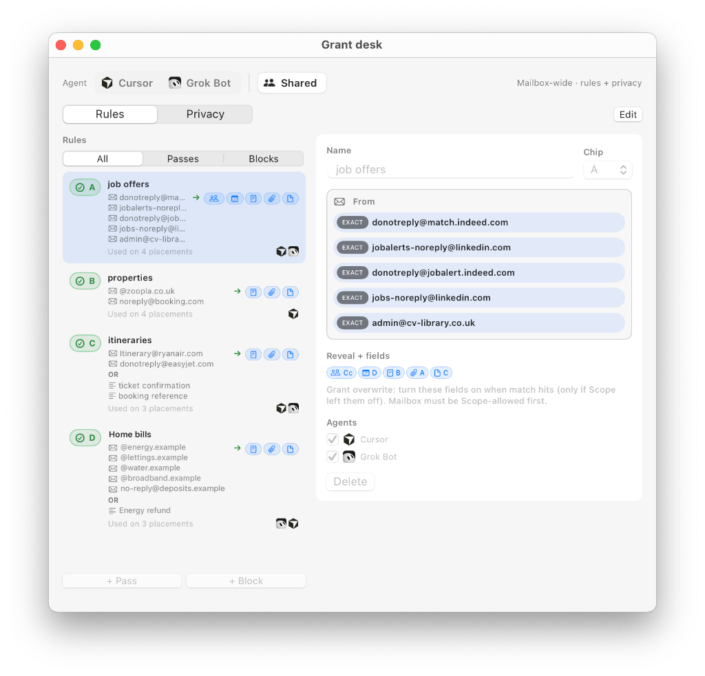
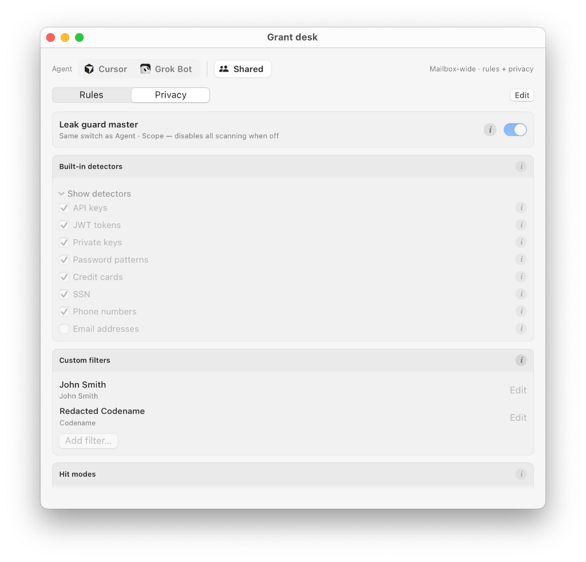
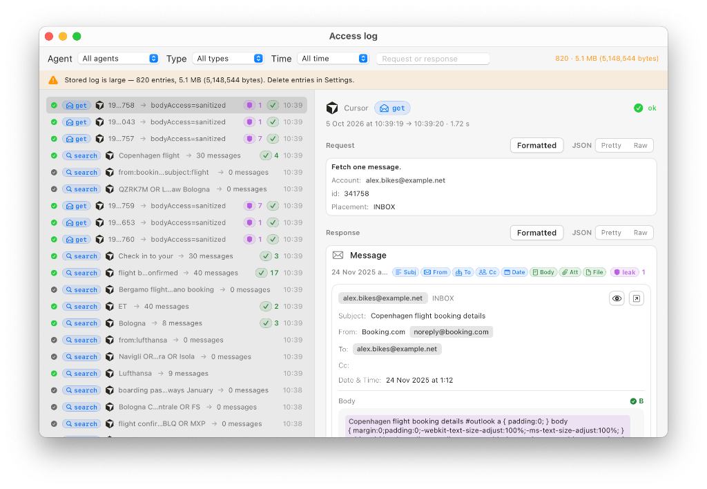
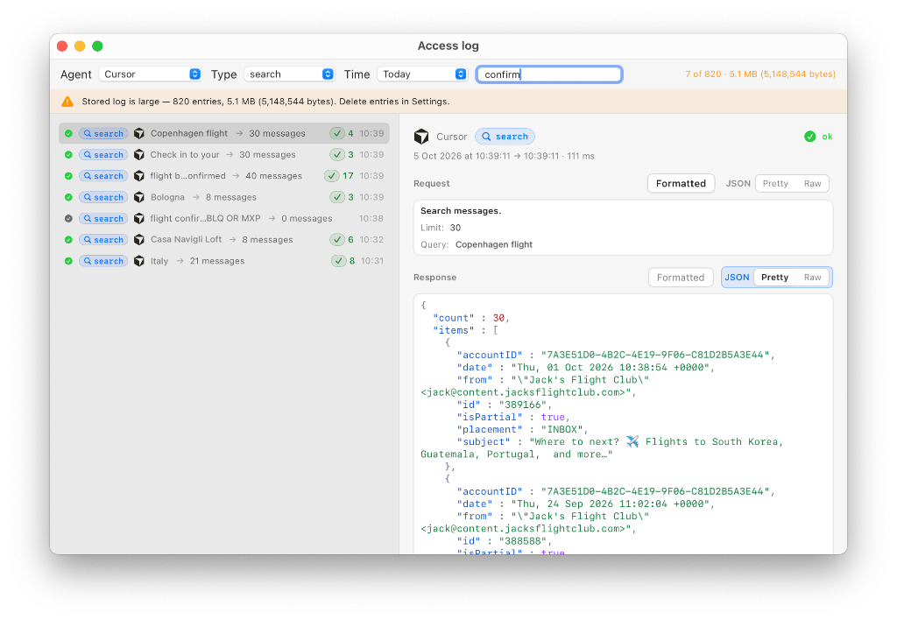

# MailGent

**0.12.0 alpha** — Let AI help with your email — without handing over your inbox. MailGent is a gatekeeper between Apple Mail and your AI agents: Cursor and Grok talk to it over local MCP, you choose the slice they can see, secrets are redacted on-device, and every request is logged.

**Early alpha.** Local Apple Mail read, per-agent grants, Ask prompts, leak guard, and a full access log work today. Agents can draft; they cannot send or delete. Gmail/Yahoo and remote agents are not in this build.

**Interactive demo:** [demo.html](https://marotron.github.io/MailGent/demo.html) — watch one agent request walk through Scope → Fields → Rules → Leak guard.

## Screenshots

Captured in **v0.8.2** — UI has changed since then, especially around Ask, the access log, and Settings.

<table>
  <tr>
    <td width="50%"><br><b>Menu bar</b> <i>(v0.8.2)</i> — access, last ingest, connected agents, last agent call.</td>
    <td width="50%"><br><b>Control center</b> <i>(v0.8.2)</i> — access health, ingest stats, one card per paired agent.</td>
  </tr>
  <tr>
    <td><br><b>Grant Desk · Scope</b> <i>(v0.8.2)</i> — allowed placements per agent, field caps, leak guard.</td>
    <td><br><b>Grant Desk · Access</b> <i>(v0.8.2)</i> — per-placement fields, presets, preview with leak guard applied.</td>
  </tr>
  <tr>
    <td><br><b>Shared · Rules</b> <i>(v0.8.2)</i> — Pass / Block overlays by From and Subject.</td>
    <td><br><b>Shared · Privacy</b> <i>(v0.8.2)</i> — built-in detectors, custom filters, hit modes.</td>
  </tr>
  <tr>
    <td><br><b>Access Log</b> <i>(v0.8.2)</i> — every agent call, with leak-guard and rule hit counts.</td>
    <td><br><b>Access Log · JSON</b> <i>(v0.8.2)</i> — the exact response the agent received.</td>
  </tr>
</table>

More in [`docs/screenshots/`](docs/screenshots/). Personal data in the screenshots (addresses, account IDs, search terms) is replaced with sample values.

## Features

What this alpha can do today. Fold new `CHANGELOG` items into the matching section on each bump.

### Local mail

- Reads Apple Mail on your Mac (`.emlx` under `~/Library/Mail`) — nothing is uploaded by MailGent
- On-device search index (SQLite FTS)
- Incremental ingest shows arrivals vs removals (e.g. `+44 −2277 → −2233`); Trash/Junk copies are not counted as new
- Menu bar and Control Center show access health, last ingest, and last agent call

**Debug builds** can use fixture mail. **Release builds use live Mail only.** Live Mail needs a readable `~/Library/Mail` (Full Disk Access, or Choose Mail Folder…).

### Agents (MCP)

- Pair **Cursor** and/or **Grok Bot** as separate machine-local agents (each gets its own Bearer)
- Loopback only: `http://127.0.0.1:8788/mcp` (port 8787 reserved for Cursor OAuth callbacks)
- Agents talk to MailGent over MCP; MailGent has no built-in AI

### Grants — what each agent may see

- Per agent: which mailboxes, From/To/date filters, deny carve-outs
- Per field: Subject, From, To, Cc, Date, Body, attachments — each **Off**, **Ask**, or **On** (cycle chips through all three)
- Attachment Names Off clears Attachment Content; Content On turns Names On
- Attachment content: when On, `get_attachment` can write a local temp file for the agent (25 MiB cap); when Ask, the same tool prompts Allow / Block for that message

### Ask — approve before sharing

- Set a field to **Ask** when you want a human decision each time (not a standing Yes)
- Turn on **Allow conditional access prompts** in Settings (off by default)
- On MCP `get`, MailGent shows an on-device **Email access request** dialog (**Allow / Block**) with a message preview; blocked fields stay withheld
- On MCP `get_attachment` with Attachment Content on Ask, MailGent prompts for that field only; Allow/Block is remembered for the message until you restart
- A missing attachment filename returns `not_available` without prompting
- Help row names the agent; expand More for field / Allow·Block detail
- HTML-only Body shows an **HTML only** badge on the title row; plain preview is derived from HTML when needed
- Preview canvas has − / + zoom (default 75%); dialog height stays compact (~560pt max)
- Concurrent `get`s queue behind the open Ask — a new prompt never auto-Blocks the one you are answering; queued prompts reuse the same window (content swap) so Allow / Block stay live after a backlog
- Red badge on the menu-bar icon (and Dock when visible) shows how many Ask prompts are open or queued

### Rules (Pass / Block)

- Shared Pass / Block overlays on mail that is already in scope (match From / Subject; optional When date window)
- Enable a rule per agent on a placement in Grant Desk

### Leak guard

- Optional on-device scan of subject/body before the agent receives mail (opt in per placement)
- Built-in detectors plus your own filters; hits can redact or withhold

### Access log

- Every agent call is logged with exactly what the agent received (sanitized / withheld overlays)
- List chips for Ask allow/block and Pass/Block hits; Preview and Open in Apple Mail from the log
- Attachment **Preview** still opens for you when the agent was denied or the file is too large; the note under the card is about agent delivery, not your preview
- Agents cannot edit the log; you can delete entries in Settings

### Drafts

- Agents can create/update drafts in a MailGent-owned ledger (in memory)
- Drafts are **not** written into Mail.app; no send from MailGent; drafts show in the Access Log

### Install (DMG)

- Pretty Finder install window: drag to Applications, plus short Gatekeeper instructions (text only)
- Background is Retina-scaled so the guide fills the DMG window on HiDPI displays

## Not working yet

Do not advertise these as shipped:

- Gmail/Yahoo OAuth
- Send / move / trash
- Approval queue
- Keychain pairing
- Persisted drafts

## Requirements

- macOS 14+
- Xcode 16 / Swift 6
- [XcodeGen](https://github.com/yonaskolb/XcodeGen)
- Apple Mail with mail already downloaded
- Access to `~/Library/Mail` (sandbox is off; [`MailGent.entitlements`](MailGent/MailGent.entitlements) is empty). Full Disk Access is one way; Choose Mail Folder… is enough for messages. Enable FDA if account names stay as UUIDs (`~/Library/Accounts`).

## Install / run

```bash
brew install xcodegen
make test
make run
make xcode
```

Menu bar only (`LSUIElement`). Settings → Access → Recheck, Open Full Disk Access, or Choose Mail Folder…

## Release (DMG)

Build a Release `.dmg` locally (output: `dist/MailGent-<version>.dmg`, version from `project.yml`):

```bash
make dmg             # package only
make release         # run tests, then package
make screenshots     # DEBUG: fixture + demo grants/rules (capture locally)
make screenshots-ci  # DEBUG: same, auto-write PNGs under dist/screenshots/
```

**CI:** pull requests and pushes to `main` run `make test` on GitHub Actions ([workflow](.github/workflows/ci.yml)). Full where/when map (tests + Release): [`docs/agents/ci-cd.md`](docs/agents/ci-cd.md).

Capture README / `docs/screenshots/` images **locally** with fixture fake data (`make screenshots`). Release tags strip screenshot-only scaffolding before the DMG. Full screenshot workflow: [`docs/agents/screenshots.md`](docs/agents/screenshots.md).

For Gatekeeper-safe distribution, set before `make dmg`:

```bash
export MAILGENT_SIGN_IDENTITY='Developer ID Application: …'
export MAILGENT_NOTARY_PROFILE='mailgent-notary'   # `xcrun notarytool store-credentials`
```

**GitHub Release:** push tag `vX.Y.Z` matching `MARKETING_VERSION` (e.g. `v0.1.8` for `0.1.8`). The [Release workflow](.github/workflows/release.yml) strips screenshot helpers, runs `make test`, builds the DMG, publishes a **pre-release** titled **`X.Y.Z alpha`**, and attaches the disk image. Notes start with that version’s section from `CHANGELOG.md`, then the install text in [`.github/RELEASE_BODY.md`](.github/RELEASE_BODY.md). Optional repo secrets: `MAILGENT_SIGN_IDENTITY`, `MAILGENT_NOTARY_PROFILE`.


```bash
git tag -s v0.1.8 -m "0.1.8 alpha"   # signed annotated tag → GitHub Verified
git verify-tag v0.1.8
git push origin v0.1.8
```

**Gatekeeper** (unsigned / ad-hoc DMGs on other Macs):

1. Drag **MailGent** → **Applications**, then open MailGent from Applications
2. If *Not Opened* (optional): click **Done** → **System Settings** → **Privacy & Security** → **Open Anyway** → confirm → Touch ID / password

The DMG window shows the same steps. GitHub Release notes repeat them ([`.github/RELEASE_BODY.md`](.github/RELEASE_BODY.md)). Agent notes: [`docs/agents/pretty-dmg.md`](docs/agents/pretty-dmg.md).

`make prototype-accounts` is a **dev CLI**, not part of the `.app`.

## Pair agents

In the companion, **Pair Cursor** and/or **Pair Grok Bot**. Same loopback URL; each agent gets its own Bearer. Grok Bot shows a copyable MCP snippet for the host to wire itself. Grants are independent per agent in Grant Desk.

On first launch with no saved pairing, MailGent pairs **Cursor** automatically. If `~/.cursor/mcp.json` exists, MailGent writes (and on revoke removes) a `mailgent` entry with the loopback URL and Cursor's Bearer. A new agent has no grants, so it sees no mail until you allow mailboxes in Grant Desk.

Tools: `search`, `list`, `list_new`, `list_placements`, `get`, `get_attachment`, `open_in_mail`, `create_draft`, `update_draft`, `status`, `update`, `set_source` (`open_in_mail` and source switch are off unless Settings allows them).

## License

SPDX `Apache-2.0`. See [`LICENSE`](LICENSE) and [`NOTICE`](NOTICE).

The names “MailGent” and the MailGent logos are trademarks of the copyright holder. Apache-2.0 does not grant trademark rights. Forks must rename.

Official binaries (when they exist) are notarized GitHub Releases. A Homebrew cask is **planned later** from that same file — not this alpha. No placeholder sha256.

## Warranty

Software is provided **AS IS**, without warranty of any kind, including fitness for a particular purpose. Mail may be lost or shown incompletely (partial `.emlx` files). This alpha does not mutate Apple Mail’s on-disk store. Time Machine or your provider’s Trash is your backstop, not a restore promise. Paired agents have their own practices — see [`PRIVACY.md`](PRIVACY.md). This license does not override consumer law where that law applies.

## Privacy

Device-first. See [`PRIVACY.md`](PRIVACY.md). Runtime data lives under `~/Library/Application Support/MailGent/`. Revoke pairing anytime.

## Roadmap

From the locked v1 spec and first-ship maps, not new invention:

- **Next train:** Gmail + Yahoo OAuth (keep local-read as a source). Yahoo commercial OAuth is still pending.
- Mutation approval queue (send, move, label, archive, flags)
- Soft delete → Trash (agent-proposeable + human). Hard/permanent delete per spec (stronger confirm; agent exposure as locked in ticket 08)
- Persistent draft ledger + companion draft UI; still no Apple Mail store writes on local-read
- Pairing polish, grant expiry, smart-folder selectors, Touch ID audit purge
- Menu bar icon polish (current SF Symbol status item; final mark and pulse animation TBD)
- Personal Apple Developer Program → Developer ID + notarized GitHub Release (Gatekeeper-friendly binary outside the App Store; ticket 16 still open). Mac App Store is hostile to `~/Library/Mail`
- In-app updates via Sparkle (check GitHub Releases, notify, user chooses to install)
- Homebrew cask of the same notarized Release artifact (custom tap first; `homebrew/cask` later)
- Later: remote/expiring sessions, `lan-inference`, iPhone/iPad, Microsoft/Proton

**Out of scope for v1:** built-in assistant, unattended remote inbox, replacing Apple Mail
