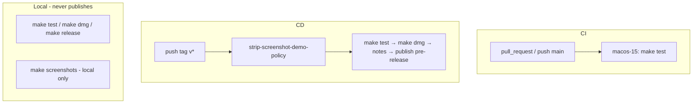

# MailGent CI/CD

Where and when tests run, and how a GitHub Release is created for this repo.

**Stack on runners:** macOS 15, XcodeGen, Swift 6, deployment target macOS 14 (`project.yml`).

## Overview

| Path | Trigger | Where | What |
|------|---------|-------|------|
| **CI** | `pull_request`, `push` to `main` | GitHub Actions `macos-15` | `make test` |
| **CD** | push tag `v*` | GitHub Actions `macos-15` | strip screenshot helpers → `make test` → `make dmg` → notes → GitHub **pre-release** + DMG |
| **Local** | you run Make | your Mac | `make test` / `make dmg` / `make release` / `make screenshots` (no GitHub Release) |

Workflows: [`.github/workflows/ci.yml`](../../.github/workflows/ci.yml), [`.github/workflows/release.yml`](../../.github/workflows/release.yml).



## Continuous integration (testing)

### When / where

| Event | Where | Runs `make test`? |
|-------|-------|-------------------|
| While coding | your Mac | only if you run `make test` |
| Open or update a PR | Actions `macos-15` | yes ([`ci.yml`](../../.github/workflows/ci.yml)) |
| Push to `main` | Actions `macos-15` | yes |
| Push ship tag `vX.Y.Z` | Release job | yes (after strip, before DMG) |
| Local `make dmg` | your Mac | no |
| Local `make release` | your Mac | yes locally; does **not** create a GitHub Release |
| Screenshot capture | your Mac only | N/A — never a GitHub Actions job |

### What `make test` is

`xcodegen generate`, then `xcodebuild` test on scheme `MailGent` for `platform=macOS,arch=arm64` (see `Makefile`).

CI installs XcodeGen with Homebrew (same untap guard as Release), then runs `make test`. In-progress runs for the same ref are cancelled (`concurrency`).

## Continuous delivery (GitHub Release)

A GitHub Release is created **only** by the Release workflow after a matching tag is pushed. Merging a PR, pushing `main`, or local `make dmg` / `make release` never publishes. Releases are marked **pre-release** (`prerelease: true`) with title **`X.Y.Z alpha`**.

### Human steps (before Actions)

1. On a `feat/…` / `fix/…` / `hotfix/…` branch: bump `MARKETING_VERSION` + build number in `project.yml`, regenerate the Xcode project, update `CHANGELOG.md` and the full `README.md` feature sections. Commit only after confirm (see `.cursor/rules/versioning.mdc`).
2. Merge to `main`.
3. On the ship commit, create a **signed** annotated tag matching `MARKETING_VERSION`, verify, push:

```bash
git tag -s v0.13.2 -m "0.13.2 alpha"
git verify-tag v0.13.2
git push origin v0.13.2
```

Tag must be `v` + semver equal to `MARKETING_VERSION` (no `-alpha` suffix on the tag). `Scripts/release/dmg.sh` fails if `RELEASE_TAG` and `project.yml` disagree. Unsigned / lightweight tags are not ship tags.

### Runner steps (after tag push)

1. Checkout (`fetch-depth: 0`).
2. Install XcodeGen.
3. **`Scripts/release/strip-screenshot-demo-policy.sh`** — removes screenshot-only scaffolding from the **runner checkout** so the DMG is not built with DEBUG demo helpers. Helpers remain in git for local `make screenshots`. Details: [`screenshots.md`](screenshots.md).
4. **`make test`**
5. **`make dmg`** with `RELEASE_TAG` set → `dist/MailGent-<version>.dmg`  
   Optional secrets: `MAILGENT_SIGN_IDENTITY`, `MAILGENT_NOTARY_PROFILE` (otherwise ad-hoc sign).
6. **`Scripts/release/notes.sh`** → `dist/RELEASE_NOTES.md` (CHANGELOG section + [`.github/RELEASE_BODY.md`](../../.github/RELEASE_BODY.md)).
7. **`softprops/action-gh-release`** — pre-release titled **`X.Y.Z alpha`**, attach DMG.

### Local packaging and screenshots (no publish)

```bash
make dmg             # package only
make release         # test then package → dist/MailGent-<version>.dmg
make screenshots     # DEBUG fixture capture on your Mac
make screenshots-ci  # same, write PNGs under dist/screenshots/
```

Optional signing locally:

```bash
export MAILGENT_SIGN_IDENTITY='Developer ID Application: …'
export MAILGENT_NOTARY_PROFILE='mailgent-notary'
make dmg
```

## Do not

- Expect a GitHub Release from a PR merge or `main` push without a `v*` tag
- Ship with a lightweight or unsigned tag
- Run screenshot capture as a GitHub Actions job
- Assume notarization without repo secrets / local notary profile
- Put version bumps for CI/docs-only work (docs/chore → no SemVer bump)
- Leave live account UUIDs / personal mail in committed screenshot PNGs

## Related

- Contributor summary: [README.md](../../README.md) Install / Release
- Screenshots + strip policy: [`screenshots.md`](screenshots.md)
- Versioning / signed tags: [AGENTS.md](../../AGENTS.md), `.cursor/rules/versioning.mdc`
- Licensing / Homebrew timing: [`licensing.md`](licensing.md)
