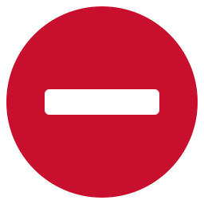

# Handoff: Rule outcome indicators (pass / block)

Traffic-sign style icons for MailGent rule decisions. Decided with Maro 2026-10-07.

## Pair

| Outcome | Meaning | Asset |
| --- | --- | --- |
| **Pass** | Rule allows (message may proceed) | [`assets/rule-pass.svg`](assets/rule-pass.svg) |
| **Block** | Rule denies (stop / no entry) | [`assets/rule-block.svg`](assets/rule-block.svg) |

## Design

- **Pass:** solid UK mandatory blue disc (`#005EA5`) with a white upright arrow (ahead / go). Avoids a green tick so it is not read as “everything is correct”.
- **Block:** solid red disc (`#C8102E`) with a centred white horizontal dash (not the white-face no-entry variant).
- Same outer diameter and stroke weight; use only for the **final rule decision**.
- Keep a separate neutral mark (grey circle / outline) for “no match / not evaluated”.

## Usage notes

- Do not reuse pass for validation success or form correctness.
- Prefer these SVGs as the source; rasterise only if a specific UI surface needs PNG.

## Source preview

Agreed look captured in chat 2026-10-07 (blue ahead + red dash).

 

Issue reference crops (today vs target) live under [`assets/refs/`](assets/refs/).

## Tracker

- Adopt marks in app → [#26](https://github.com/marotron/MailGent/issues/26)
- Broader icon/color unification → [#27](https://github.com/marotron/MailGent/issues/27)
- Local wayfinder: `.scratch/mailgent-ui-icons/`
